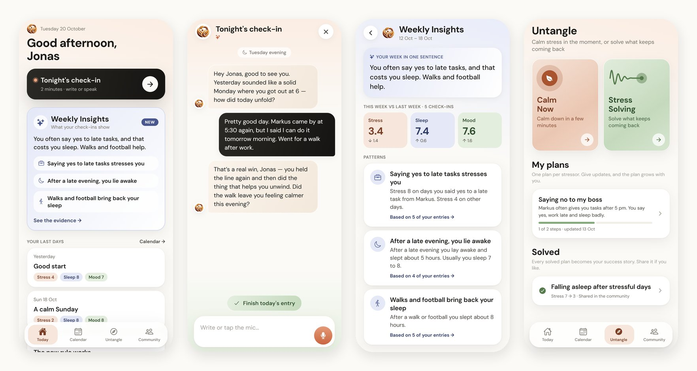
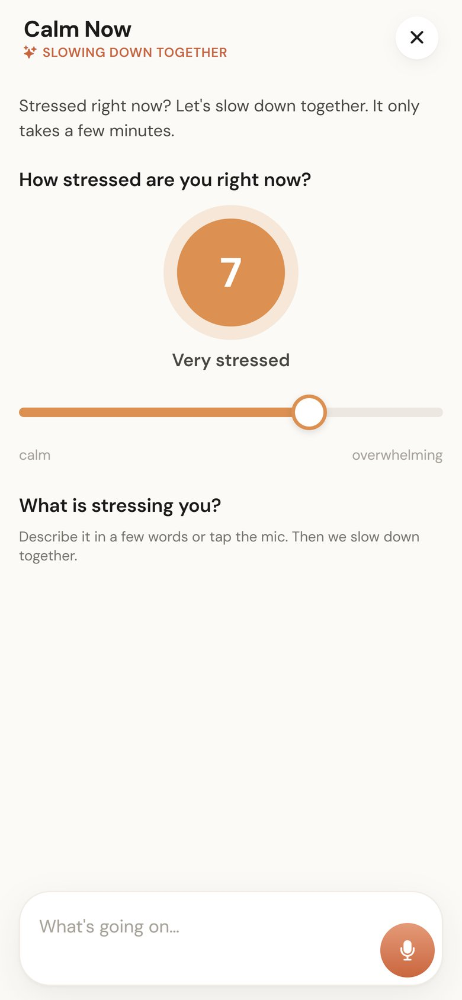
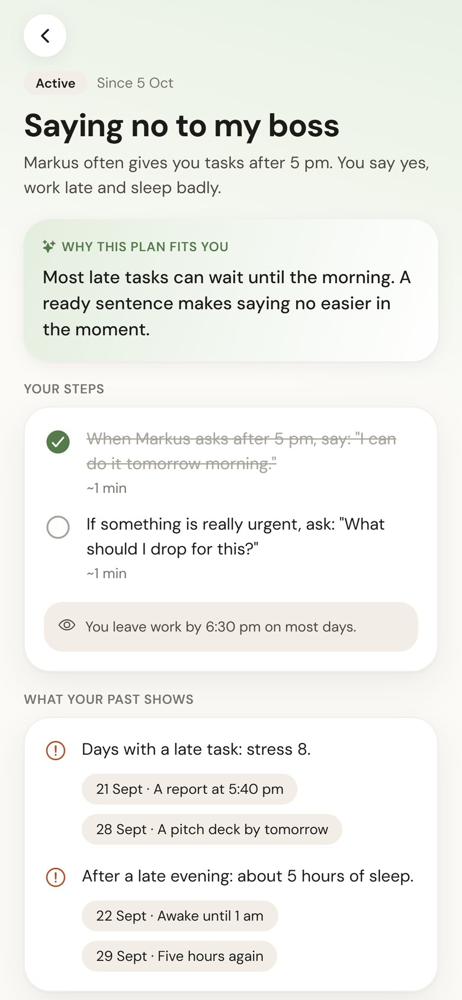
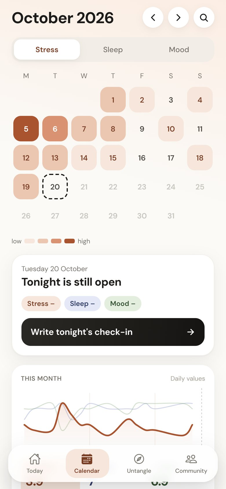
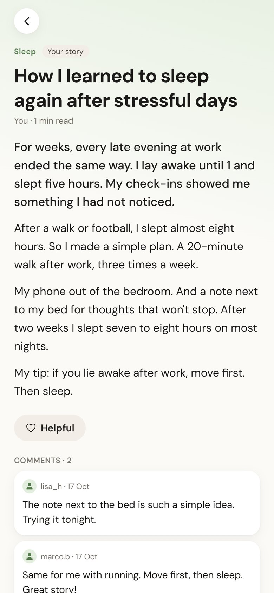
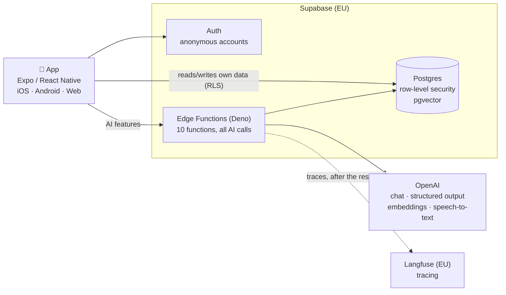

# Destress AI

**An AI companion for everyday stress.** Instead of filling in mood sliders, you talk with Destress AI for a few minutes each evening. It reads your stress, sleep and mood from the conversation, finds the patterns in your days, and helps you calm down in the moment or solve what keeps coming back.

**[▶ Try the live demo](https://destress-ai.vercel.app)** · works in any browser, on desktop with a phone frame · "Load the demo" shows four weeks of the demo persona Jonas



---

## Contents

- [The idea](#the-idea)
- [Features](#features)
- [Architecture at a glance](#architecture-at-a-glance)
- [How the AI works](#how-the-ai-works)
- [Key decisions](#key-decisions)
- [Security, privacy and cost](#security-privacy-and-cost)
- [Observability](#observability)
- [Lessons learned](#lessons-learned)
- [What's next](#whats-next)
- [How it was built](#how-it-was-built)
- [Tech stack and running it](#tech-stack-and-running-it)

**Deeper reading:** [Architecture](docs/architecture.md) · [Decisions](docs/decisions.md) · [Lessons learned](docs/lessons-learned.md)

---

## The idea

Stress and mood trackers are popular in the app stores, but most of them are generic: you type in the same numbers every day, and nothing much happens with them. Destress AI replaces the manual tracking with a short evening conversation. The AI picks up stress, sleep and mood on the way, suggests the values with a short reason each (you confirm or adjust), remembers what matters, and connects the dots across weeks: *"Saying yes to late tasks stresses you. Walks and football bring back your sleep."* When stress hits, it helps right away. When something keeps coming back, it works out a plan with you, based on your own history.

## Features

| | Feature | What the user gets | AI behind it |
|---|---|---|---|
| 🌙 | **Evening check-in** | A warm 2-minute conversation, typed or spoken. Afterwards: stress, sleep and mood (0–10) with a reason each, to confirm or adjust. One entry per day, in a calendar. | Streaming chat with memory and RAG over past check-ins · structured output for the values · speech-to-text |
| 📈 | **Weekly Insights** | Once a week: the week vs. the last, three patterns with numbers, what helped, a question for the week ahead. Every finding links to the days behind it. | Code computes the statistics, the model interprets them · citations validated against real entries |
| 🍃 | **Calm Now** | Stressed right now? A stress slider, a calming minute of guided breathing when it's high, then a short conversation with exercises that fit where you are. Before → after rating. | Context-aware prompt (situation, what helped before, no repeated exercises) |
| 〰️ | **Stress Solving** | For stress that keeps coming back: the AI asks until it understands, then makes a plan from your own check-ins. Give updates and the plan adapts; mark it solved to get a success story. | Hidden readiness signal decides when "Make my plan" appears · structured plan with evidence · plan versions |
| 💬 | **Community** | Short, anonymous stories from people who solved similar stress, matched to what you're dealing with. Share your own; comment. | AI writes and anonymizes the post · AI moderation for kindness, privacy and crisis signals · embedding-based "For you" ranking |

<table>
<tr>
<td></td>
<td></td>
<td></td>
<td></td>
</tr>
<tr>
<td align="center">Calm Now</td>
<td align="center">A plan with evidence</td>
<td align="center">Calendar and month chart</td>
<td align="center">Community story</td>
</tr>
</table>

## Architecture at a glance



- **The app never talks to the AI directly.** Every AI call runs in an Edge Function; API keys exist only there.
- **The database protects itself.** Row-level security on every table: a user can only ever read and write their own rows, whatever the client sends.
- **One request, one function.** E.g. `checkin-chat` streams the evening conversation, `checkin-complete` extracts the values and saves the entry in one transaction.

→ Request flows, data model and all functions: [docs/architecture.md](docs/architecture.md)

## How the AI works

The AI patterns used, and where:

| Pattern | Where | Why |
|---|---|---|
| **Streaming** | Check-in, Calm Now, Stress Solving | The reply appears word by word as soon as the model starts writing, instead of all at once at the end |
| **Structured outputs** (strict JSON schema) | Check-in values, plans, insights, moderation | The model must return exactly the fields the app needs; no parsing of free text |
| **RAG, small-to-big** | Check-in chat, Untangle, search | Each check-in is split into topic chunks for the search, but the model gets the *whole* original conversation |
| **"Code counts, the model interprets"** | Weekly Insights | Averages and comparisons are computed in code; the model only explains them, so numbers can't be hallucinated |
| **Validated citations** | Insights, plans | The model cites entries by short labels (E1, E2 …); code maps them back to real ids and drops findings without valid evidence |
| **LLM as moderator** | Community posts and comments | Checks kindness, privacy (names, places) and crisis signals before anything is published |
| **Hidden control signals** | Stress Solving | The model appends `[[ready]]` when it knows enough; the app strips it and shows "Make my plan" |
| **Memory** | Check-in | After each check-in the model updates a short profile ("what matters to Jonas"), used in the next conversation |
| **Provider-neutral interface** | All AI calls | Functions talk to an `LLMProvider` interface; OpenAI is one adapter, models are set per task via secrets |

→ Pipelines in detail: [docs/architecture.md](docs/architecture.md#ai-pipelines)

## Key decisions

| Decision | Why | Alternative considered |
|---|---|---|
| **Expo / React Native** | One codebase for iOS, Android and a web demo | Native apps (twice the work), web-only (not a real app) |
| **Supabase** (Postgres, RLS, Edge Functions, Auth) | Security in the database, server code next to the data, EU region | Firebase (no SQL, no pgvector), own backend (more to run) |
| **AI only on the server** | Keys never ship in the app; quotas and moderation can't be bypassed | Calling OpenAI from the app (key would be public) |
| **AI suggests, the user decides** | Values come with reasons and can be adjusted; values set by hand always win | Fully automatic tracking (no trust, no correction) |
| **pgvector in the same database** | RAG search respects the same row-level security; one system | Separate vector database (second system, own access rules) |
| **One transaction for saving a check-in** | Five writes either all succeed or none; AI calls happen before it | Separate writes (half-saved check-ins on errors) |
| **Quota fails closed, tracing fails open** | Cost protection must never be skipped; observability must never break the app | Treating all checks the same |

→ All decisions with context: [docs/decisions.md](docs/decisions.md)

## Security, privacy and cost

- **Row-level security** on every table; the community feed is read only through database functions that never expose user ids.
- **Anonymous accounts** on first start: no email or name needed. User ids in logs and traces are pseudonymous.
- **Keys only in Edge Functions** (Supabase secrets); the app only holds the public project key.
- **Voice input** is transcribed and immediately discarded; audio is never stored.
- **AI moderation** before anything is published; stories are anonymized, and comments are checked too.
- **Crisis detection:** check-ins and Untangle classify a risk level; at elevated risk the app shows help resources instead of tips.
- **Cost limits:** per-user (80) and global (4000) daily AI calls, enforced in the database, failing closed, plus a spending limit at OpenAI.
- **Tracing privacy:** for real users, all text is masked before it leaves the server; only demo accounts (fictional data) are traced in full. Data stays in the EU.

## Observability

Every request is traced with **[Langfuse](https://langfuse.com)** (EU region): the whole path from receiving the request to the last streamed byte, with the database steps and AI calls nested inside.

```
checkin-chat                      6.6 s   (the request: user message in, reply out)
 ├─ check-quota                           database
 ├─ load-context                          database: memory, recent check-ins, metrics, plans
 ├─ find-related                          RAG
 │   ├─ embed                             AI: the message as a vector
 │   ├─ match-chunks                      database: vector search (titles + similarity)
 │   └─ load-conversations                database
 └─ chat                                  AI: the streamed reply (tokens, cost, time to first token)
```

Built without an SDK: spans are sent as OpenTelemetry JSON over HTTP, after the response (`waitUntil`), and nested automatically via `AsyncLocalStorage`. → [docs/architecture.md](docs/architecture.md#observability)

## Lessons learned

The short version; each with the full story in [docs/lessons-learned.md](docs/lessons-learned.md).

1. **One vector per conversation dilutes the meaning.** A check-in about four topics wasn't found for any of them. Topic chunks + small-to-big retrieval: the exam query went from *not found* to rank 2, rent from rank 3 to rank 1.
2. **Models believe their own words.** Old AI suggestions in the context were later treated as facts about the user. Fix: label who said what, and tell the model its own lines aren't facts.
3. **Never let a model invent references.** Short labels instead of ids, validated in code: 0 hallucinated citations reached the user.
4. **A silent `catch` hid a broken feature.** After a refactor, RAG in the check-in chat quietly returned nothing. The traces made it visible: the `embed` step was simply missing.
5. **Prompts need context rules, not just tone.** Calm Now suggested "look around the room" to someone lying in bed in the dark, and repeated breathing right after a guided breathing minute.
6. **Shared state in a public demo needs care.** Every demo restart published the demo story again; the feed filled with duplicates until demo stories became private to their account.
7. **Measure before claiming a fix.** A warm-up ping takes over the ~3 s function start, but the first real search still took 10.7 s (then 2.8 s, then 1.0 s): the rest happens inside the first real request, where a ping can't reach.
8. **Keep AI calls out of transactions.** Saving a check-in wrote to five places one after another; now all AI work runs first and one database transaction saves everything or nothing.

## What's next

- **Quality scores in Langfuse** from real use: Calm Now stress drop, how often users correct the AI's values.
- **Evals:** a small dataset (crisis, Calm Now rules, extraction) run against each prompt change, with rule checks and an LLM judge.
- **Faster check-in save:** saving takes ~18 s, mostly one structured-output call; candidates are a faster extraction model and moving memory/indexing to the background.
- **Real accounts:** upgrade anonymous accounts to email or Apple/Google sign-in without losing data.

## How it was built

I designed Destress AI starting from my own concept and mockups. The project was set up in July 2026; the main build followed in October 2026. I made the product, UX and architecture decisions (for example the topic-chunk RAG design, the Untangle and community concepts, and the demo persona) and wrote the implementation together with **Claude Code** (Anthropic's coding agent) as a pair programmer: I directed each step, reviewed the code, tested it in the browser and on my phone, and iterated on the details. I can explain every part of it, and the [decisions](docs/decisions.md) and [lessons](docs/lessons-learned.md) are written down so that's easy to check.

## Tech stack and running it

**App:** Expo SDK 57 · React Native 0.86 · TypeScript · expo-router · Reanimated · react-native-svg · zustand
**Backend:** Supabase (Postgres, pgvector, row-level security, Auth, Edge Functions on Deno)
**AI:** OpenAI Responses API (chat, structured outputs), `text-embedding-3-small`, speech-to-text · Langfuse tracing
**Web demo:** static export on Vercel, with a phone frame on desktop

```bash
npm install
cp .env.example .env          # Supabase URL + publishable key (public by design)
npm run web                   # or: npx expo start (iOS/Android via Expo Go)
```

Server side: `supabase/migrations` (schema), `supabase/functions` (Edge Functions). Secrets (`OPENAI_API_KEY`, `LANGFUSE_*`, model names) are set in Supabase, never in the repo. End-to-end tests with the real AI (written during development, not re-run after the latest changes): `npm run test:checkin`, `test:rag`, `test:untangle`, `test:community`, `test:deep-dives`, `test:rls`.

<sub>Screenshots: `node scripts/screenshots.mjs && python scripts/optimize-screenshots.py`</sub>
