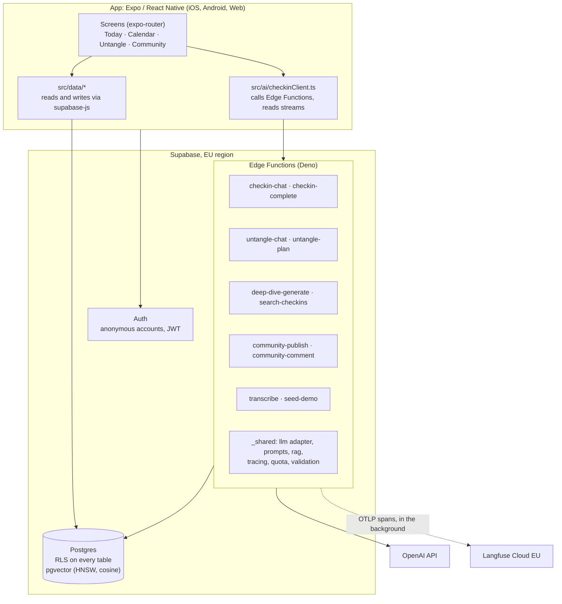
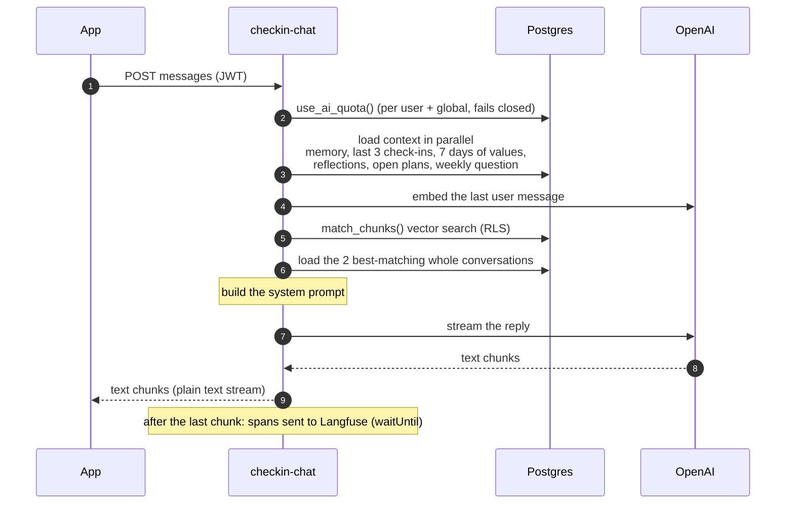
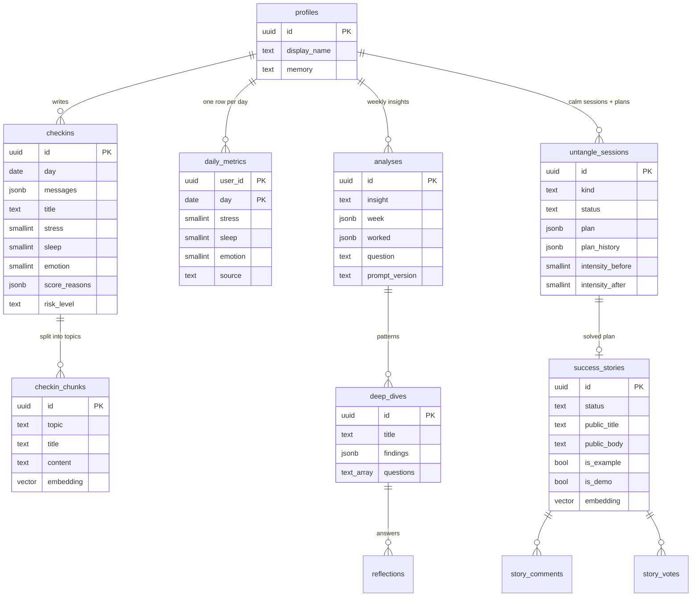

# Architecture

How Destress AI fits together: the parts, what happens on a request, the data model, the AI pipelines, security and observability. For *why* things are built this way, see [decisions.md](decisions.md).

- [Overview](#overview)
- [What happens when you send a message](#what-happens-when-you-send-a-message)
- [Saving a check-in (one transaction)](#saving-a-check-in-one-transaction)
- [Edge Functions](#edge-functions)
- [Data model](#data-model)
- [AI pipelines](#ai-pipelines)
- [Security model](#security-model)
- [Observability](#observability)
- [Web demo and deployment](#web-demo-and-deployment)
- [Project structure](#project-structure)

---

## Overview



**Two ways the app reaches data:**

1. **Directly** with `supabase-js` for plain reads and writes: the calendar, plans, adjusting a day's values. Row-level security makes this safe: the database checks every row against the caller's id.
2. **Through an Edge Function** for anything involving the AI. The function runs *as the user* (their JWT is passed on, so RLS still applies) and holds the secrets the app must never see.

---

## What happens when you send a message

The evening check-in, one turn. Everything inside `checkin-chat` is one Langfuse trace.



**The system prompt** combines: who the user is (name + memory), how the last days went (recent check-ins and values), open Untangle plans to follow up, the weekly question, and up to two related past conversations from RAG. The prompt tells the model that old conversations are optional context and that its own earlier lines there aren't facts about the user (see [lessons](lessons-learned.md#2-models-believe-their-own-words)).

---

## Saving a check-in (one transaction)

When the user taps **Finish today's entry**, `checkin-complete` runs:

```
1. load-context          profile (name, memory) + open plans
2. json:checkin          AI, structured output: title, summary, mood,
                         stress/sleep/mood 0–10 with a reason each, themes,
                         what helped, follow-ups, risk level, topics (for RAG),
                         outcomes of open plans, updated memory
3. embed                 AI: one vector per topic chunk
4. save-checkin          ONE database call: save_checkin()
```

`save_checkin()` is a Postgres function, so its five writes form a single transaction:

| # | Write | Rule |
|---|---|---|
| 1 | `checkins` | One entry per day: update today's entry if it exists, otherwise insert |
| 2 | `daily_metrics` | Values the user set by hand win; scores the conversation didn't cover keep their old value |
| 3 | `profiles.memory` | The updated memory for the next check-in |
| 4 | `checkin_chunks` | Old chunks deleted, new ones inserted, in the same transaction |
| 5 | `untangle_sessions` | Outcome of each open plan the conversation talked about |

**All AI work happens before the transaction.** A slow or failing AI call can't leave half a check-in behind, and the transaction itself takes milliseconds. If only the embedding fails, the entry is saved without chunks, and `indexMissing()` adds a whole-check-in chunk the next time the RAG search runs.

The function is `security invoker`: it runs with the caller's rights, so RLS applies to every statement exactly as with single requests.

Afterwards the app shows the **review step**: the suggested values with their reasons, which the user confirms or adjusts. Adjusted values are saved as `source = 'manual'` and win from then on.

---

## Edge Functions

All in `supabase/functions/`, each wrapped in `withSupabase({ auth: 'user' })` (verifies the JWT, creates an RLS client) and `traced()` (Langfuse). Each one checks the AI quota first.

| Function | What it does | AI calls |
|---|---|---|
| `checkin-chat` | One turn of the evening conversation, streamed | embed → chat |
| `checkin-complete` | Extracts values, topics, memory; saves in one transaction | structured output → embed |
| `deep-dive-generate` | Weekly Insights: code computes the week, the model finds patterns with citations | structured output |
| `search-checkins` | Semantic search over the user's check-ins | embed |
| `untangle-chat` | Calm Now (`mode: 'calm'`) or Stress Solving (`mode: 'plan'`), streamed | embed → chat |
| `untangle-plan` | Turns a Stress Solving conversation into a plan, or a new version of it | embed → structured output |
| `community-publish` | Preview: the AI writes an anonymized post. Publish: final check, then saved with the service role | structured output → embed |
| `community-comment` | Moderates and anonymizes a comment, then saves it with the service role | structured output |
| `transcribe` | Speech-to-text; the audio is never stored | speech-to-text |
| `seed-demo` | Loads the demo persona Jonas into an empty account, relative to today's date | embed |

**Shared modules** (`supabase/functions/_shared/`):

| Module | Purpose |
|---|---|
| `llm/` | The provider-neutral interface (`LLMProvider`, `Embedder`, `Transcriber`) and the OpenAI adapter. Models per task come from secrets (`LLM_CHAT_MODEL`, `LLM_EXTRACT_MODEL`, `LLM_ANALYSIS_MODEL`, `EMBED_MODEL`, `TRANSCRIBE_MODEL`) |
| `prompts.ts`, `extraction.ts` | The check-in prompt, the extraction prompt and its JSON schema |
| `analysis.ts` | Weekly Insights: week statistics in code, prompt, schema, citation validation |
| `untangle.ts` | Calm Now and Stress Solving prompts, plan schema and validation, context loading |
| `rag.ts` | Topic chunks, indexing, vector search, small-to-big conversation loading |
| `community.ts` | Writing, anonymizing and moderating posts and comments |
| `quota.ts` | Daily AI limits (fails closed) |
| `tracing.ts` | Langfuse tracing (fails open) |
| `validation.ts` | Input checks: message format and length, dates, languages |

---

## Data model



Every table has `user_id` (default `auth.uid()`) and RLS policies. Also: `story_reports` (3 reports hide a story), `ai_usage` (daily counters, no user access).

**Migrations** (`supabase/migrations/`) tell the story of the project in order: initial schema → Deep Dives → embeddings → topic chunks → Untangle → community → one check-in per day → Weekly Insights → plan history → blog + comments → AI quota → private demo stories → the check-in transaction.

---

## AI pipelines

### Evening check-in
- **Chat:** streamed, warm, adaptive; covers stress, sleep and mood naturally; follows up on open plans and the weekly question; uses related past conversations when they help.
- **Extraction:** one structured-output call with a strict JSON schema. The transcript labels user messages (`U1`, `U2` …), so the model can say which messages belong to which topic; code fills in the exact words.
- **Review:** the user confirms or adjusts each value; the reasons explain the suggestion.

### RAG: topic chunks, small-to-big
1. **Index:** each check-in is split into topic chunks (category, title, summary, the user's own words), one embedding each (`text-embedding-3-small`, 1536 dimensions), stored in `checkin_chunks` with an HNSW cosine index.
2. **Search:** `match_chunks()` finds the nearest chunks under RLS; code keeps the best chunk per check-in and applies a minimum similarity (0.3: German↔English matches score around 0.32–0.36).
3. **Small-to-big:** the chat doesn't get the chunk, it gets the **whole conversation** the chunk came from. The small chunk is good for finding, the whole conversation is good for understanding.

Why not one vector per check-in, or per message: see [lessons](lessons-learned.md#1-one-vector-per-conversation-dilutes-the-meaning).

### Weekly Insights
- **Code** computes this week vs. last week (averages, deltas, check-in count) and prepares the entries.
- **The model** gets the facts and the entries labelled `E1, E2 …` and returns 1–3 patterns, each with findings that cite labels, plus what worked and a question for the week ahead.
- **Validation:** labels are mapped back to real ids; unknown labels are dropped, and findings with fewer than two valid citations are removed (counted as `dropped_findings`).
- **Timing:** generated automatically when the app opens, at least 7 days after the last one and with at least 3 new check-ins.

### Calm Now
- Stress slider → description → at 7 or more: a short note why calming the body comes first, then one minute of guided breathing.
- The prompt knows: the situation, what helped before (past sessions and check-ins), active plans, whether the guided breathing just happened. Rules: every exercise must fit where the user is (in bed: eyes closed, no "look around"); never repeat an exercise; at most two short sentences per reply, ending with a question or one small task.
- At the end: "I feel calmer" → before/after rating, saved with the session.

### Stress Solving
- **Chat:** asks until it understands the trigger, what's in the user's control and what they tried. When it knows enough, it appends a hidden `[[ready]]` marker (allowed after at least 2 answers, forced after 5); the app strips it and shows **Make my plan**.
- **Plan:** structured output with title, problem, approach (at most 30 words, based on one concrete thing from the user's history), 1–3 steps, what to watch for, and lessons from the past that cite check-ins (validated like the insights).
- **Living plan:** "Give an update" continues the same thread; "Update my plan" writes a new version and keeps the old one in `plan_history`. **Mark as solved** creates a private success story.

### Community
- **Write:** from a solved plan, the AI drafts a short personal blog post from the plan and the user's own words, and anonymizes it (names, places, employers). The user edits it.
- **Moderate:** before publishing, the final text is checked again for privacy, kindness and crisis signals; comments go through the same check. Only the server (service role) can set a story to published.
- **Read:** `community_feed()` is a `security definer` function that returns stories without any user ids. "For you" ranks by cosine similarity between each story and the average of the reader's own check-in chunks.

---

## Security model

| Layer | Protection |
|---|---|
| **Database** | RLS on every table; policies compare `user_id` with `auth.uid()`. Column privileges on `success_stories`: users can't set a story to published. Feed and story reads only through `security definer` functions that return no user ids. |
| **Functions** | Every function verifies the JWT, runs database calls as the user, validates input, and checks the daily quota (80 calls per user, 4000 overall) before any AI call. The service role key is only used for the few writes users must not do themselves (publishing, comments, the demo flag). |
| **Secrets** | `OPENAI_API_KEY`, `LANGFUSE_*` and the service role key exist only as Supabase secrets. The app holds only the public project URL and publishable key. |
| **AI safety** | Risk level in check-ins and Untangle → crisis resources instead of tips. Moderation before publishing. Prompts forbid diagnoses. |
| **Demo** | `seed-demo` sets `app_metadata.demo = true` with the service role; users can't change `app_metadata`, so tracing can trust it. Demo stories are only visible to their own account. |

---

## Observability

`_shared/tracing.ts` traces every request with Langfuse, without an SDK:

- **`traced(name, handler)`** wraps a function: it opens the root span (the whole request), runs the handler, and closes the span when the response is complete. For a streamed reply that's after the last chunk: the stream is passed through a `TransformStream` that notices its end.
- **`span(name, fn)`** times one step. `AsyncLocalStorage` remembers which span is running, so steps and AI calls inside it become children automatically, also in shared helpers that know nothing about tracing ("context propagation").
- **AI calls** are reported by the OpenAI adapter through a `record(call)` callback (model, input, output, token usage, timing, time to first token, errors) and become *generations*.
- **Sending:** spans are converted to OpenTelemetry JSON (`langfuse.*` attributes) and posted to Langfuse's OTLP endpoint in the background with `EdgeRuntime.waitUntil`, so the user never waits.
- **Fails open:** without keys, or when Langfuse is slow or down (5 s timeout), tracing is skipped and the request works as before. GET requests (warm-up pings) aren't traced.
- **Privacy:** for real users, every input and output is replaced by its shape and size (`[masked: 412 chars]`) before it leaves the server; numbers stay. Demo accounts are sent in full.

**Warm-up:** on app start, `src/lib/warmup.ts` sends a GET to each function. `traced()` answers it right away with 204, before any quota check or AI call, but the request starts the function, so the first real use skips most of the cold start.

---

## Web demo and deployment

- **Web build:** `expo export -p web` (single-page app) → `scripts/web-routing.mjs` prepares it for Vercel: every URL serves `index.html`, link-preview meta tags, and the `assets/node_modules` folder renamed (Vercel never uploads folders named `node_modules`, which made fonts and icons disappear).
- **Deploy:** `npm run deploy:web` copies the build outside the repo and deploys it with the Vercel CLI.
- **Phone frame:** on a wide screen, `src/components/PhoneFrame.tsx` shows the app in a realistic phone, with a pitch, "How it works", a demo button and a QR code for opening it on a phone. On phones it renders the app unchanged.
- **Demo persona:** `supabase/functions/_shared/fixtures/demo-jonas.ts`: four weeks of Jonas, dated relative to today, so the demo always looks recent.
- **Backend deploys:** `npx supabase db push` (migrations), `npx supabase functions deploy <name> --use-api` (functions).

---

## Project structure

```
src/
  app/                 screens (expo-router, file-based routing)
    (tabs)/            Today, Calendar, Untangle, Community (+ hidden older screens)
    diary/new.tsx      the evening check-in chat
    untangle/          Calm Now, Stress Solving, plan page
    deep-dives.tsx     Weekly Insights
    story/, success/   community article, sharing a success story
  components/          design system: chat, motion, TrendChart, PhoneFrame, review …
  data/                reading and writing app data (supabase-js, RLS)
  ai/checkinClient.ts  calls to the Edge Functions, stream reading
  lib/                 auth, demo, warm-up, dates, supabase client
  store/               zustand store (name, onboarding, demo flag)
supabase/
  migrations/          the schema, in order
  functions/           Edge Functions + _shared modules
scripts/               end-to-end tests, web build/deploy, screenshots
docs/                  this documentation
```
